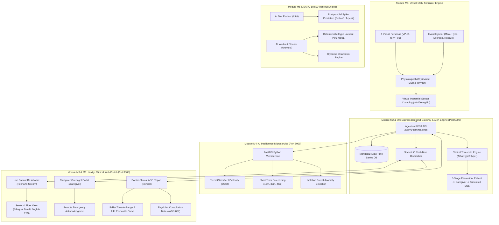

# GlucoGuard — AI-Powered Continuous Glucose Monitoring & Intelligent Emergency Response System

[](http://localhost:3000)
[](http://localhost:3000/simulation)
[](./AGENTS.md)
[](http://localhost:3000/clinical)

> **MANDATORY HEALTHCARE SIMULATION NOTICE (ADR-007)**  
> GlucoGuard is a software-based healthcare simulation prototype developed as an autonomous final-year engineering project. It is **NOT** a certified medical device and is **NOT** intended for clinical diagnosis, patient management, or medical treatment.  
> * All continuous glucose telemetry is generated synthetically via the Virtual CGM Simulator Engine (`"source": "simulation"`).
> * The system does **NOT** measure live human biology or vital signs.
> * The system must **NEVER** prescribe insulin dosages, drug amounts, or pharmaceutical titration regimens.
> * Absence of patient acknowledgment during alerts represents strictly an unacknowledged simulation event, **never** a medical confirmation of unconsciousness.
> * Emergency dispatch workflows (ambulance / caregiver SOS) are **100% simulated**; no real-world emergency services (911/112/local EMS) or telecom gateways are contacted.

---

## 1. System Overview & Architecture

GlucoGuard demonstrates an intelligent closed-loop glycemic oversight and emergency escalation ecosystem designed for patients, family caregivers, and endocrinologists.



---

## 2. Monorepo Structure

```text
final-prj/
├── apps/
│   ├── web/                     # Next.js 14 App Router Frontend (Port 3000)
│   │   ├── src/app/
│   │   │   ├── page.js          # Patient Dashboard & Senior View Switcher
│   │   │   ├── simulation/      # Virtual CGM Simulation Lab & Event Injector
│   │   │   ├── diet/            # AI Diet Planner & Macronutrient Logger
│   │   │   ├── workout/         # AI Workout Planner & Safety Interlocks
│   │   │   ├── emergency/       # Emergency Hub & Escalation Tracker
│   │   │   ├── caregiver/       # Caregiver Oversight & Multi-Patient Grid
│   │   │   └── clinical/        # Doctor AGP Report & Consultation Notes
│   │   └── tests/               # Jest & React Testing Library Suites (52 tests)
│   └── api/                     # Node.js + Express + Socket.IO Backend (Port 5000)
│       ├── src/
│       │   ├── simulator/       # Virtual CGM Engine & 6 Patient Personas (M1)
│       │   ├── models/          # Mongoose Schemas (Readings, Meals, Activities, Notes, Alerts)
│       │   ├── modules/alerts/  # Clinical Thresholds & Escalation Engine (M7)
│       │   ├── controllers/     # Modular REST Endpoint Controllers
│       │   └── routes/          # Express API Route Dispatchers
│       └── tests/               # Node Test Runner Integration Suites (77 tests)
├── services/
│   └── ai-engine/               # Python 3.10+ FastAPI Microservice (Port 8000)
│       ├── models/              # Trend Analytics, Forecasting, Diet, Workout Models
│       ├── routers/             # FastAPI Route Endpoints
│       └── tests/               # Pytest AI Service Verification Suite (31 tests)
├── docs/                        # Architecture Decisions (ADRs), TASKS, Master Plan, Review Logs
├── scripts/
│   └── demo_runner.js           # Full-Stack Demonstration Orchestrator & Preflight CLI
├── package.json                 # Monorepo Workspace Configuration
└── README.md                    # System Documentation (This file)
```

---

## 3. Comprehensive Feature Matrix (Modules M1 to M8)

| Module | Title | Key Architectural & Clinical Capabilities |
|---|---|---|
| **M1** | **Virtual CGM Simulator Engine** | 6 Clinical Personas (VP-01 Healthy, VP-02 Managed T1D, VP-03 Brittle T1D, VP-04 T2D, VP-05 Pre-Diabetic, VP-06 Athlete); AR(1) stochastic noise; diurnal circadian rhythm; event injection (`meal_spike`, `hypo_drop`, `exercise`, `rescue_carbs`); physiological boundary clamping [40, 400] mg/dL. |
| **M2** | **Data Ingestion & Persistence Pipeline** | Express REST API; MongoDB Mongoose time-series models; Socket.IO WebSockets gateway; simulation header middleware (`X-Simulation-Mode: true`); payload schema validation. |
| **M3** | **Patient Dashboard & Accessibility Mode** | Live Recharts streaming curves; dynamic trend arrows (`↑`, `↗`, `→`, `↘`, `↓`); 3-zone Time-in-Range gauge bar. **Senior Mode** with giant 72px typography, plain-language guidance, and 4-tier resilient Bilingual Tamil / English Text-to-Speech (TTS) audio engine with asynchronous voice hydration and phonetic fallback. |
| **M4** | **AI Intelligence Engine** | Python FastAPI service; Savitzky-Golay / EMA trend filtering; short-term predictive forecasting for 15, 30, and 45 minutes; Isolation Forest anomaly detection; target breach early warning alerts. |
| **M5** | **AI Diet Planner** | Diabetic-friendly macronutrient logging (carbohydrates, protein, fat, fiber, Glycemic Index); postprandial glycemic spike prediction ($\Delta G$ and $T_{\text{peak}}$); healthy low-GI dietary substitution swaps (ADR-009). |
| **M6** | **AI Workout Planner** | Activity catalog (walking, cycling, jogging, HIIT, yoga); deterministic Hypoglycemia Lockout ($<90$ mg/dL or falling rapidly $<-1.5$ mg/dL/min); Hyperglycemia Caution ($>250$ mg/dL); exercise drawdown dynamics engine (ADR-010). |
| **M7** | **Emergency Response Engine** | Critical threshold detection (Severe Hypo $<54$ mg/dL, Precipitous Drop $<-2.5$ mg/dL/min, Severe Hyper $>300$ mg/dL); 3-tier deterministic escalation protocol (Stage 1: 60s Patient Siren Countdown $\rightarrow$ Stage 2: Caregiver Push/SMS Notification $\rightarrow$ Stage 3: Simulated EMS Ambulance Dispatch with GPS tracking and ETA); 15-minute smart alert suppression cooldown (ADR-011). |
| **M8** | **Caregiver & Doctor Clinical AGP Portal** | **Caregiver Portal (`/caregiver`)**: Multi-patient live telemetry grid, active emergency notification banner, and 1-click remote emergency acknowledgment. **Doctor AGP Portal (`/clinical`)**: International consensus standard Ambulatory Glucose Profile (Battelino et al. 2019), 5-Tier Time-in-Range stacked meter, Glycemic Variability ($CV \le 36\%$), GMI (estimated HbA1c), 24-hour percentile curve (10th, 25th, 50th median, 75th, 90th), modal day stability heatmap, and physician consultation notes with ADR-007 non-prescriptive safety interlock (ADR-012). |

---

## 4. Interactive Route Sitemap

| Route URL | Module | Role / Purpose |
|---|---|---|
| `http://localhost:3000` | M3 | **Patient Dashboard**: Real-time glucose telemetry, trend arrows, TIR gauge, and Senior & Voice Mode toggle. |
| `http://localhost:3000/simulation` | M1, M2 | **Virtual CGM Simulation Lab**: Interactive control panel, persona switcher (VP-01 to VP-06), speed multiplier, and dynamic metabolic event injector (`meal_spike`, `hypo_drop`, `exercise`, `rescue_carbs`). |
| `http://localhost:3000/diet` | M5 | **AI Diet Planner**: Nutritional food logging, macronutrient analysis, postprandial spike forecasting, and low-GI food swaps. |
| `http://localhost:3000/workout` | M6 | **AI Workout Planner**: Activity logging, clinical safety interlocks (hypo lockout check), and projected glycemic drawdown. |
| `http://localhost:3000/emergency` | M7 | **Emergency Response Hub**: Multi-stage escalation tracker, simulated ambulance dispatch tracking, siren audio controls, and incident history. |
| `http://localhost:3000/caregiver` | M8 | **Caregiver Oversight Portal**: Multi-patient dependent monitoring cards, urgent alert escalation banner, and remote caregiver acknowledgment. |
| `http://localhost:3000/clinical` | M8 | **Doctor AGP Clinical Report**: International consensus Ambulatory Glucose Profile, 5-tier TIR bar, GMI, $CV$, 24-hour percentile curve, modal day heatmap, and physician consultation notes. |
| `http://localhost:5000/health` | M2 | **Backend API Health Check**: Express operational status and MongoDB Atlas connection state. |
| `http://localhost:8000/health` | M4 | **AI Engine Health Check**: Python FastAPI operational status and ML model readiness. |

---

## 5. Quick Start & Demonstration Guide

### Prerequisites
- **Node.js**: v18.0.0 or higher (v20+ recommended)
- **Python**: v3.10+ (with `venv` and `pip`)
- **Git**

### Installation

1. **Clone the repository:**
   ```bash
   git clone https://github.com/azhik-xo/final_prj.git
   cd final_prj
   ```

2. **Install Node.js dependencies across monorepo workspaces:**
   ```bash
   npm install
   ```

3. **Configure Python AI Engine Virtual Environment:**
   ```bash
   cd services/ai-engine
   python -m venv .venv
   
   # Windows PowerShell:
   .venv\Scripts\Activate.ps1
   # Linux/macOS:
   source .venv/bin/activate

   pip install -r requirements.txt
   cd ../..
   ```

4. **Environment Configuration:**
   Ensure environment variables exist in `apps/api/.env` and `apps/web/.env.local`.  
   *(If MongoDB Atlas credentials are not provided, the system automatically falls back to in-memory simulated persistence with zero interruption).*

---

### Running the Preflight Readiness Check

To verify environment variables, Python virtual environment, dependencies, and port availability:
```bash
npm run demo:check
```

---

### Starting the Full Monorepo Ecosystem

Launch all 3 services concurrently (Express API, Next.js Web, FastAPI AI Engine) with unified color-coded logging:
```bash
npm run dev:all
# or
node scripts/demo_runner.js
```

Once running, navigate to:
* **Web Application:** [http://localhost:3000](http://localhost:3000)
* **Backend Ingestion API:** [http://localhost:5000](http://localhost:5000)
* **AI Intelligence Engine:** [http://localhost:8000/docs](http://localhost:8000/docs) (Interactive OpenAPI documentation)

---

## 6. Automated Verification & Testing Protocol

GlucoGuard maintains comprehensive test suites spanning all 3 technology stacks:

```bash
# 1. Run all Node.js Backend API tests (77 unit, integration, and E2E tests):
npm test --prefix apps/api

# 2. Run all Next.js Frontend tests (52 component, interaction, and accessibility tests):
npm test --prefix apps/web

# 3. Run all Python AI Intelligence Engine tests (31 machine learning and algorithmic tests):
services\ai-engine\.venv\Scripts\pytest.exe services\ai-engine\tests

# 4. Run Next.js Production Build verification (All 11 routes statically prerendered):
npm run build --prefix apps/web

# 5. Run Full Monorepo Multi-Module Integration Test:
node --test apps/api/tests/e2e.test.js
```

### Complete Test Count Summary:
* **`apps/api`**: 77 passed / 0 failed (23 suites: simulator, health, integration, diet, activity, alert, clinical, e2e)
* **`apps/web`**: 52 passed / 0 failed (6 suites: page, seniorView, diet, workout, emergency, clinical)
* **`services/ai-engine`**: 31 passed / 0 failed (test_ai_engine, test_diet_engine, test_health, test_workout_engine)
* **Total Automated Tests**: **160 tests passing with 100% pass rate**.

---

## 7. Healthcare Safety & Regulatory Boundaries

In compliance with **ADR-007**, the following clinical boundaries are strictly hardcoded across the entire monorepo:
1. **Mandatory Simulation Tag:** Every reading, event, and database record contains `"source": "simulation"`.
2. **Prominent UI Banners:** Sticky top banners across all views alert users that the platform is an educational simulation.
3. **Strict Non-Prescription Interlock:** Under no circumstances will the system compute or recommend insulin units, titration protocols, or drug dosages. Clinical recommendation forms reject direct medication prescriptions with an active validation error.
4. **Non-Clinical Loss-of-Consciousness Disclaimer:** Unacknowledged alarms reflect unacknowledged simulation events, never a clinical diagnosis of unconsciousness.
5. **Simulated SOS Only:** The emergency dispatch workflow is entirely simulated; no 911 or emergency telecoms are reached.

---

## 8. License & Academic Attribution

GlucoGuard is developed as a Final-Year Engineering Simulation Prototype. Developed autonomously under the **GlucoGuard Autonomous Agent Collaboration Protocol** ([`AGENTS.md`](./AGENTS.md)).  
&copy; 2026 GlucoGuard Engineering Team. All rights reserved.
